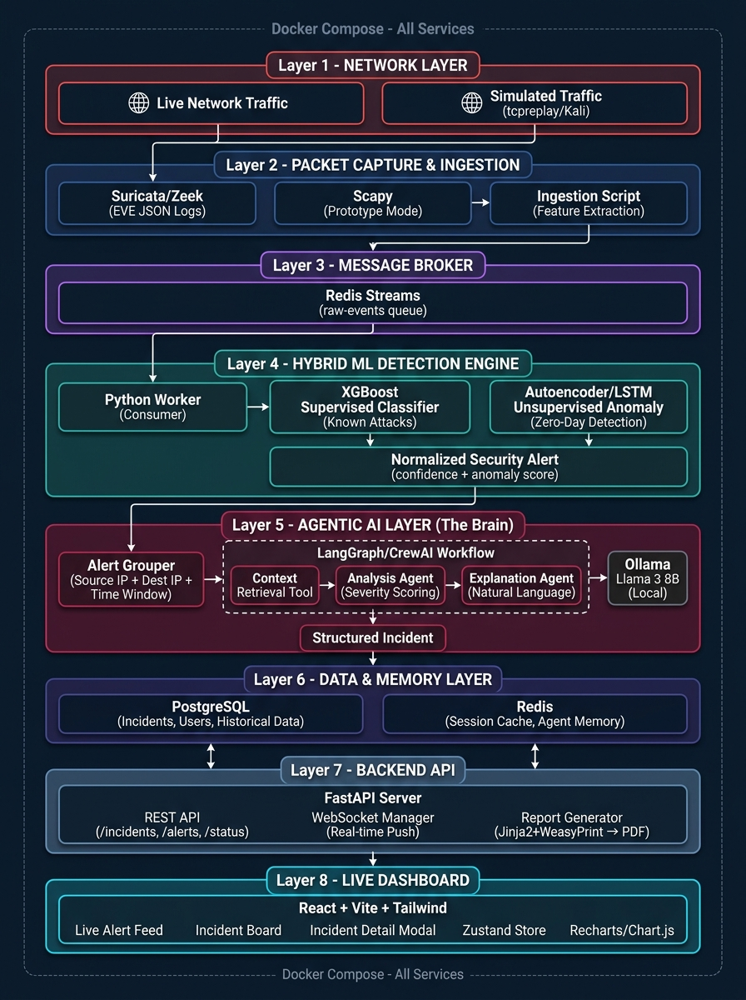
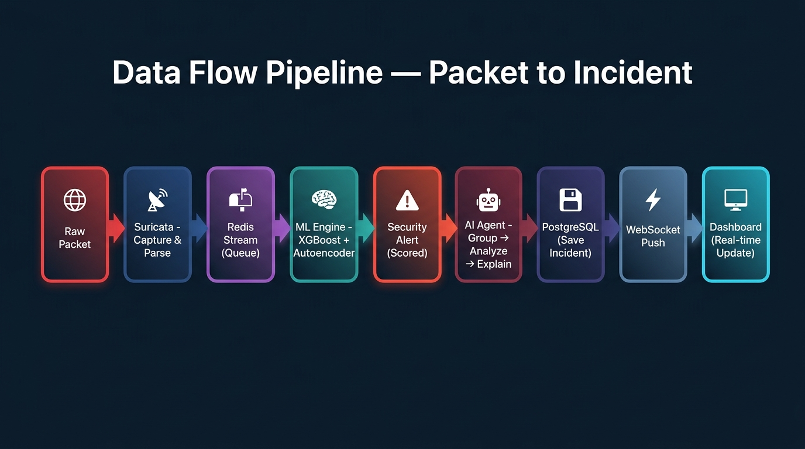
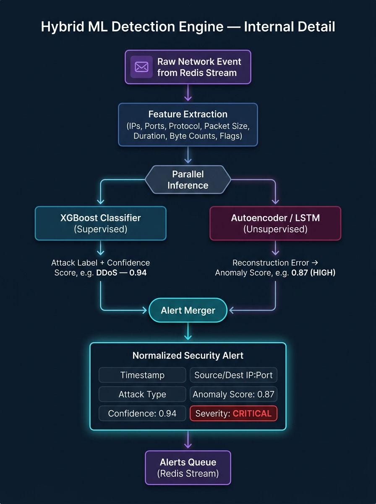
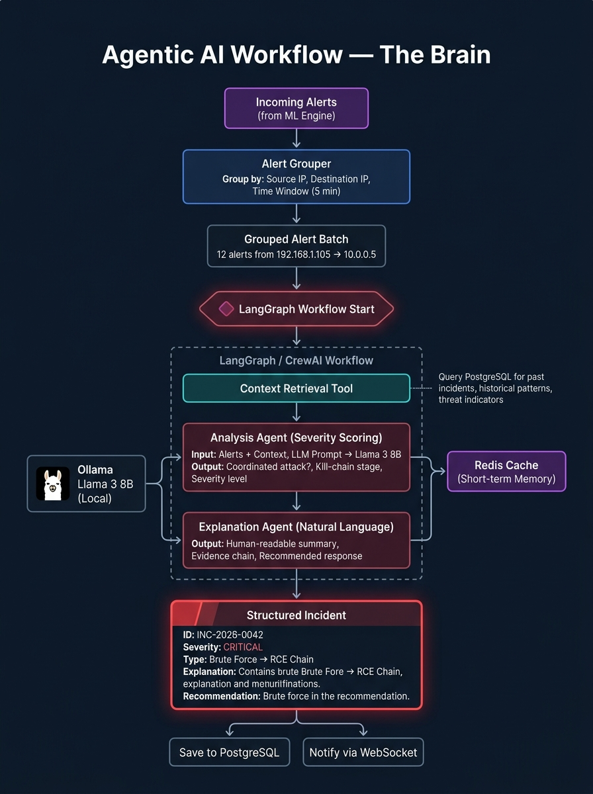
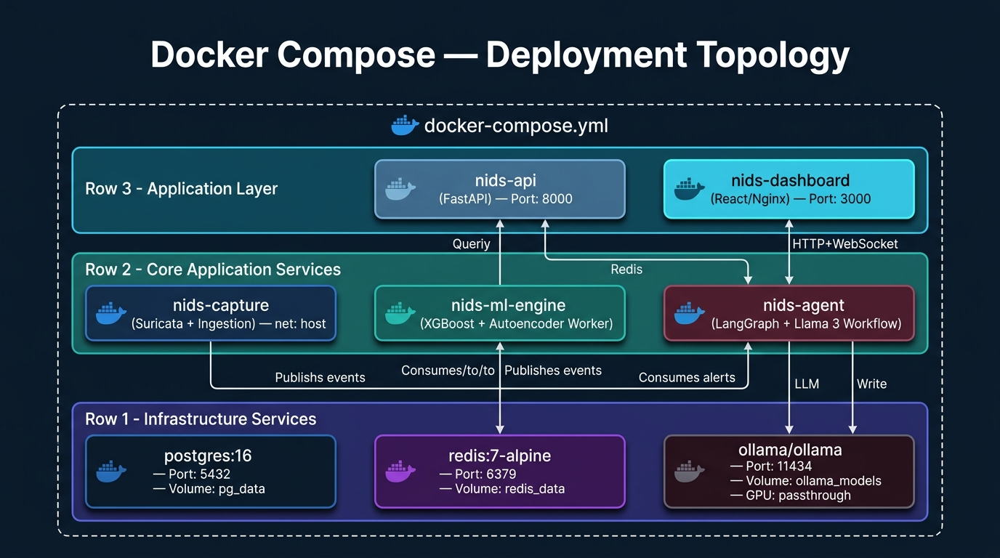

# 🛡️ NIDS — Complete Architectural Workflow Diagram

---

## 1. Master System Architecture (End-to-End)

The full picture — every component and how data flows from raw network packets to the analyst's screen, all wrapped inside a Docker Compose orchestration layer.

---

## 2. Data Flow Pipeline (Simplified Linear View)

A clean, linear view of how a single network packet becomes an incident on the analyst's screen — 9 steps from capture to dashboard.

---

## 3. Hybrid ML Detection Engine — Internal Detail

How the two models work in parallel to catch both known and unknown threats. XGBoost handles supervised classification of known attack types, while the Autoencoder/LSTM detects zero-day anomalies via reconstruction error.

---

## 4. Agentic AI Workflow — The Brain

The LangGraph/CrewAI agent workflow that transforms noisy ML alerts into actionable, explained incidents. Alerts are grouped by IP and time window, enriched with historical context from PostgreSQL, analyzed and explained by Mistral 7B via Ollama.

---

## 5. Docker Compose — Deployment Topology

How all 8 services are orchestrated as containers — from infrastructure (PostgreSQL, Redis, Ollama) through core services (Capture, ML Engine, Agent) to the application layer (FastAPI, React Dashboard).

---

## 6. Component-to-Technology Mapping

| Component | Technology | Role |
|:---|:---|:---|
| Packet Capture | **Suricata** / Zeek / Scapy | Sniff, parse, and extract network flow features |
| Message Broker | **Redis Streams** | Decouple capture → ML → Agent with async queues |
| Supervised ML | **XGBoost** | Classify known attack types (DDoS, Brute Force, etc.) |
| Unsupervised ML | **PyTorch Autoencoder / LSTM** | Detect zero-day anomalies via reconstruction error |
| Alert Grouper | **Python (custom)** | Batch alerts by IP + time window before agent analysis |
| Agent Orchestrator | **LangGraph** / CrewAI | Define multi-step agent workflow with tool use |
| Local LLM | **Ollama + Mistral 7B** | Reason, correlate, score severity, generate explanations |
| Agent Memory | **Redis** | Store short-term context between agent invocations |
| Persistent Storage | **PostgreSQL** | Store incidents, users, historical data |
| Backend API | **FastAPI** | REST + WebSocket server |
| Real-time Push | **WebSockets** | Stream new incidents to the dashboard instantly |
| Report Generator | **Jinja2 + WeasyPrint** | Render incident data into downloadable PDFs |
| Frontend | **React + Vite + Tailwind** | Live dashboard with alerts feed, incident board, charts |
| State Management | **Zustand** | Manage complex real-time UI state |
| Visualization | **Recharts / Chart.js** | Charts and graphs for traffic & threat analytics |
| Deployment | **Docker Compose** | Orchestrate all services as containers |
